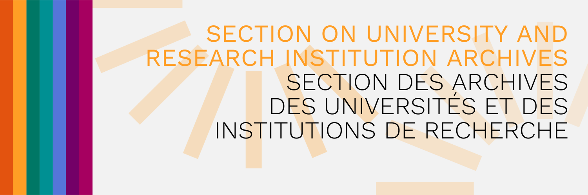

<h2>EVOLVING TOGETHER</h2>
<h3>COLLECTIVE MEMORY, COMMUNITY KNOWLEDGE, AND THE CHANGING LANDSCAPE OF ARCHIVAL PRACTICES</h3>
 
<h4>11 - 13 November 2027 | BANGALORE, INDIA</h4>
 

Link to this page: [https://archives.ncbs.res.in/icasuv27](https://archives.ncbs.res.in/icasuv27)

### CALL FOR PAPERS

The International Council on Archives Section on University and Research Institution Archives is pleased to announce a call for papers for its annual conference to be held at the Archives at NCBS, a History of Science in Contemporary India (HOSCI) archives in Bangalore, India, in collaboration with the Trans-Disciplinary University, Bangalore.

Host: Archives at NCBS, a History of Science in Contemporary India (HOSCI) archives in Bangalore, India, in collaboration with the Trans-Disciplinary University, Bangalore.

The theme, “Evolving Together: Collective Memory, Community Knowledge, and the Changing Landscape of Archival Practices” refers both to the value of national and international connections and collaboration and to community archiving.

The conference will bring together perspectives across various registers of the collective from social interest groups to indigenous communities to professional bodies, and explore global modes of archiving a collective's knowledge, working through questions of resources and intent, and developing thoughtful approaches to discovery and access to a collective's histories with the involvement of community members.

We invite the exploration of the evolving relationships between collectives, communities, and archival processes, examining how changing forms of participation, authority, collaboration, and stewardship have shaped archival theory and practice. It also invites historical and contemporary perspectives on the ways communities influence archival processes and how those processes, in turn, contribute to the formation, representation, and continuity of collective identities.

This conference will bring together archivists, records managers, researchers, students, and allied professionals from across India and around the world to share research, practice, and perspectives on university and research institution archives in a rapidly changing global landscape.

THROUGH THE THEME LENS, WE WELCOME PROPOSALS ON, BUT NOT LIMITED TO:

- Contemporary issues and innovations in university and research institution archives
- Archival practice in diverse cultural, regional, and linguistic contexts
- Teaching, training, and professional development
- Digital archives, preservation, and access
- Community engagement, inclusion, and social justice, including projects around updates in archival description, arrangement and public access.
- Collaborations across archives, libraries, museums, and research institutions
- Case studies, practical solutions, and emerging models
- The role of university and research archives in advancing knowledge and societal impact
- The role of artificial intelligence tools in the intersection of collective memory, community knowledge, and archival methods.
- The interplay of feminist principles, community knowledge and archival theory
- Alignment and divergences of FAIR and CARE principles for archival material, including access and sensitivity protocols.

We especially encourage proposals that highlight your particular part of the world’s perspectives in order to foster dynamic and engaging dialogue.

We are looking for a range of perspectives on these topics from both a humanities and scientific perspective with a focus on university and research institution archives. We invite proposals for talks (lightning rounds and otherwise), panels, workshops and informal discussions. 

Please note that while only papers in English will be accepted as English is the conference’s official language, translation technology is currently being investigated. Speakers’ registration, travel and accommodation fees will not be covered although some bursaries will be available contingent upon funding.

We encourage you all to submit as we are hoping for a diverse range of speakers and proposals.Hybrid conference technology is also being reviewed and updates on this point will follow shortly.

How to submit: Please complete this<TKTK change link> form by 15 January 2027. We expect to have finalised the programme by 28 February 2027 and registration to open by 15 Mar 2027.

<wa-callout variant="brand" markdown="block">
### Key Dates
##### Call for Proposal: November 15, 2026
##### Deadline: Jan 15, 2027
##### Review Committee Decisions: Feb 28 2027
##### Registration Open (for speakers and attendees): Mar 15 2027
##### Presenter confirmations: Mar 31 2027
##### Registration Close: Apr 15 2027
##### Final Schedule: Aug 15 2027
##### Conference: Nov 11-13, 2027
</wa-callout>