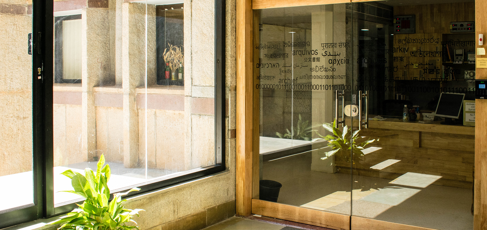

---
# Feel free to add content and custom Front Matter to this file.

layout: default
---

# Welcome to the Archives at NCBS

<!-- 
<wa-button variant="brand" href="/willamette/style-guide">View the Willamette Style Guide</wa-button>
 -->

----
<figure>
    
</figure>

    <wa-card align="center" class="card-header">
        <h3 slot="header">1876</h3>
         The oldest archives entry 
    </wa-card>
    <wa-card align="center" class="card-header">
        <h3 slot="header">100+</h3>
         Collections 
    </wa-card>
    <wa-card align="center" class="card-header">
        <h3 slot="header">400K+</h3>
         Objects 
    </wa-card>
    <wa-card align="center" class="card-header">
        <h3 slot="header">700+</h3>
         Subjects 
    </wa-card>
    <wa-card align="center" class="card-header">
        <h3 slot="header">40+</h3>
          Terabytes of data 
    </wa-card>

<!-- **Generated by v2.2.2**
{:style="text-align:center"} -->
