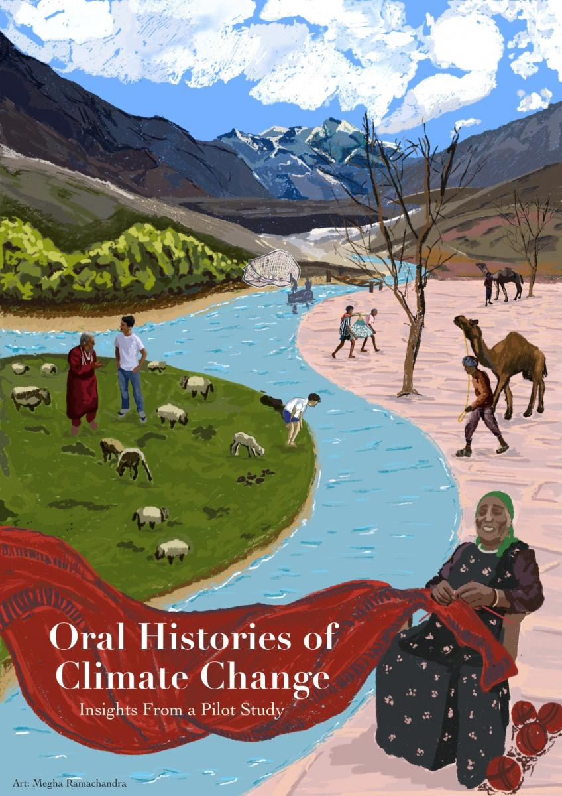

Insights from a Pilot Study

The Oral Histories of Climate Change (OHCC) project began as a three-way collaboration between colleagues in the Archives at National Centre for Biological Science (NCBS), Centre for Public History, Srishti Manipal Institute of Art, Design and Technology and the Oral History Collective at Newcastle University. It was funded by a grant from the Global Partnership Fund at Newcastle University to the National Centre for Biological Sciences amounting to 7,500 GBP, toward a three-way partnership between oral historians in India and England through designing a pilot to gain a better understanding of intergenerational impact on climate consciousness.

Along with these institutions, this project has benefited from advisory input from other organisations, namely the Nature Conservation Foundation, Sahjeevan, the Kutch Mahila Vikas Sangathan, Canopy Collective, and the Punarchith Collective. 

The Oral Histories of Climate Change project (2023 - 2025) asked how insights from diverse experiences of climate change can be generated by gathering oral histories, particularly when the interviewers are not oral historians but rather researchers or community members embedded in different landscapes.   

AR Vasavi, Rohan Arthur, Sushma Iyengar, Rajeshwari Raina, Rahi Soren, Kulbhushan Suryawanshi and Nandini Velho provided valuable advice, guidance, and mentoring. Indira Chowdhury and Graham Smith conducted the trainings, aided by additional sessions by Siddhi Bhandari, Elza D’Cruz, Gaurab Talukdar, Sayani Saha and Venkat Srinivasan. Taksh Sangwan provided assistance with the mapping. Al Badush, Siddhi Bhandari, Rajeswari B.T., Joyshree Chanam, Rigzen Dorjay, Krutika Haraniya, Priyanjana Pramanik, Sayani Saha, Rahi Soren, Gaurab Talukdar and Tanzin Thinley conducted the interviews included in the pilot project. We are grateful to our interviewees, Bachu Jamru Ayub Amin, Ghurali Das, Chanam (ongbi) Bidhumukhi Devi, Madhavi Devi, Sandhya Dhal, Bijoli Ghorai, Mullapura Kalpeni, Gurubari Mardi, Mullakuva, Funchock Namgail, Fathimath Suhra and Nawang Tharchen, who were generous with their time and with their life stories. 

The interviewers acknowledge their positionality as researchers who were, in many cases, outsiders to the communities they were embedded in and the landscapes in which they worked, and hope that they have done justice to the stories entrusted to them.

Report lead: Priyanjana Pramanik, along with support and feedback from project leads, and individual interviewers. 

Design: Megha Ramachandra.

Oral Histories of Climate Change: Insights from a Pilot Study (2025) by Priyanjana Pramanik, Indira Chowdhury, Graham Smith, Siddhi Bhandari, Elza D’Cruz, Gaurab Talukdar, Sayani Saha, Venkat Srinivasan, Al Badush, Rajeswari B.T., Joyshree Chanam, Rigzen Dorjay, Krutika Haraniya, Rahi Soren, Gaurab Talukdar, Tanzin Thinley, Bachu Jamru Ayub Amin, Ghurali Das, Chanam (ongbi) Bidhumukhi Devi, Madhavi Devi, Sandhya Dhal, Bijoli Ghorai, Mullapura Kalpeni, Gurubari Mardi, Mullakuva, Funchock Namgail, Taksh Sangwan, Fathimath Suhra and Nawang Tharchen is licensed under CC BY-NC-ND 4.0, Creative Commons Attribution-NonCommercial-NoDerivatives 4.0 International. To view a copy of this license, visit [https://creativecommons.org/licenses/by-nc-nd/4.0/](https://creativecommons.org/licenses/by-nc-nd/4.0/)

Date of publication: November 2025, Bangalore. 

