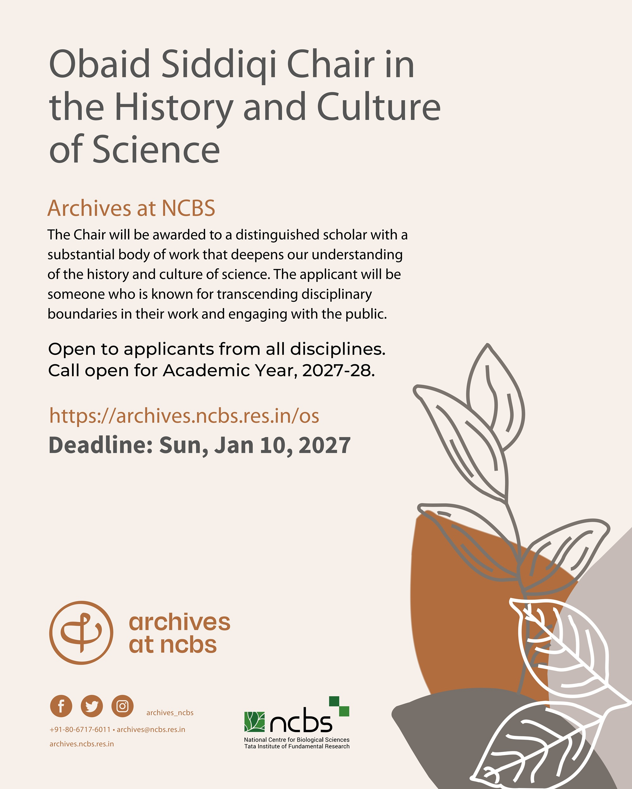

Link to this page: [https://archives.ncbs.res.in/os](https://archives.ncbs.res.in/os)
 

The Archives at National Centre for Biological Sciences (NCBS) is delighted to announce its call for the Obaid Siddiqi Chair in the History and Culture of Science. The Chair is named after Obaid Siddiqi, the founder of the Molecular Biology Unit at the Tata Institute of Fundamental Research (TIFR) and whose sustained vision led to the development of NCBS. The Chair is supported by TNQ Foundation.

 

## Dates for Academic Year 2027-2028
Application Submission Deadline: **Sun, Jan 10, 2027**
Award Confirmation: End April 2027
Duration: ~Aug 2027 - Jul 2028 (Start and end dates are flexible; the duration is one year)

If you would like to nominate someone, please do send us an email at archives@ncbs.res.in or point them toward this website. All nominated applicants will still be requested to submit the form below. Any nomination letters will be added to the application package for the review committee.

The Chair leads a much-needed effort to bridge the gap between the Sciences, Social Sciences and Humanities, and fosters a diverse and inclusive community of academics across disciplines. With this focus on a cross-disciplinary approach and the Archives as a foundational ‘lab’, the Chair also helps build teaching and research capacity of academics at the intersection of the sciences and humanities. This is part of a broader effort in developing a programme in the History and Culture of Science.

Applicants are requested to review the scope for the Obaid Siddiqi Chair's tenure (outlined below) and tailor their statement to this scope.

### Application form: [https://forms.gle/7LiRYtoekjVE6xHM7](https://forms.gle/7LiRYtoekjVE6xHM7)

<figure>
    
</figure>

## Obaid Siddiqi Chair, 2026-27

Paromita Vohra is the sixth Obaid Siddiqi Chair in the History and Culture of Science at the Archives at NCBS for the academic year, 2026-27. Vohra is an award-winning filmmaker, writer, and digital creator known for films such as Working Girls (2025), Partners in Crime (2012), and UnLimited Girls (2002), and for founding Agents of Ishq, a groundbreaking digital platform on sex and love that began in 2015. As the Obaid Siddiqi Chair, Vohra aims to explore how 'uncategorisable', in the context of archives, can be understood not as a lack, but as a quality with its own force. Using the collections from the history and culture of science in contemporary India housed at the Archives at NCBS, among other sources, she will look into the methods, tools, and aesthetic strategies that such a condition demands, and the challenge that it might pose to the authority of familiar classifications. More here: https://news.ncbs.res.in/research-explained/paromita-vohra-sixth-obaid-siddiqi-chair-history-and-culture-science-2026-2027
 

## Past and current occupants of the Obaid Siddiqi Chair

Obaid Siddiqi Chair 2021-22: MD Madhusudan\
[https://news.ncbs.res.in/spotlight/listening-stories-our-people-lands-and-waters](https://news.ncbs.res.in/spotlight/listening-stories-our-people-lands-and-waters)

Obaid Siddiqi Chair 2022-23: GN Devy\
[https://news.ncbs.res.in/spotlight/bringing-science-history-social-sciences-one-table](https://news.ncbs.res.in/spotlight/bringing-science-history-social-sciences-one-table)

Obaid Siddiqi Chair 2023-24: Gita Chadha\
[https://news.ncbs.res.in/spotlight/prof-gita-chadha-appointed-obaid-siddiqi-chair](https://news.ncbs.res.in/spotlight/prof-gita-chadha-appointed-obaid-siddiqi-chair)

Obaid Siddiqi Chair 2024-25: Savithri Preetha Nair\
[https://news.ncbs.res.in/spotlight/dr-savithri-preetha-nair-appointed-fourth-obaid-siddiqi-chair](https://news.ncbs.res.in/spotlight/dr-savithri-preetha-nair-appointed-fourth-obaid-siddiqi-chair)

Obaid Siddiqi Chair 2025-26: Samira Sheikh\
[https://news.ncbs.res.in/spotlight/dr-samira-sheikh-fifth-obaid-siddiqi-chair-history-and-culture-science-2025-26](https://news.ncbs.res.in/spotlight/dr-samira-sheikh-fifth-obaid-siddiqi-chair-history-and-culture-science-2025-26)

Obaid Siddiqi Chair 2026-27: Paromita Vohra\
[https://news.ncbs.res.in/research-explained/paromita-vohra-sixth-obaid-siddiqi-chair-history-and-culture-science-2026-2027](https://news.ncbs.res.in/research-explained/paromita-vohra-sixth-obaid-siddiqi-chair-history-and-culture-science-2026-2027)

The Obaid Siddiqi Lectures: [https://www.ncbs.res.in/events/osl](https://www.ncbs.res.in/events/osl)

 
<wa-callout variant="brand" markdown="block">
### Planning Dates for Academic Year 2027-2028

##### Application Submission Deadline: Sun, Jan 10, 2027
##### Award Confirmation: April 2027
##### Duration: ~Aug 2027 - Jul 2028 (Start and end dates are flexible; the duration is one year)

If you would like to nominate someone, please do send us an email at archives@ncbs.res.in or point them toward this website. All nominated applicants will still be requested to submit the form below. Any nomination letters will be added to the application package for the review committee.
</wa-callout>
 
 

### Scope for the Chair

The Chair will lead a much-needed effort to bridge the gap between the Sciences, Social Sciences and Humanities, and foster a diverse and inclusive community of academics across disciplines. With this focus on a cross-disciplinary approach and the Archives as a foundational ‘lab’, the Chair will also help build teaching and research capacity of academics at the intersection of the sciences and humanities. This is part of a broader effort in developing a programme in the History and Culture of Science. 

#### Description
The Chair will be awarded to a distinguished scholar with a substantial body of work that deepens our understanding of the history and culture of science. The applicant will be someone who is known for transcending disciplinary boundaries in their work and engaging with the public. The Chair will work closely with the Archives at NCBS to reimagine the role of the archive in both academic and the public spaces.
#### Duration
The Chair is held for a 12-month period, and in residence on the NCBS campus in Bangalore.
#### Eligibility
We invite applications from individuals around the world. There are no restrictions on the applicant’s discipline or on completed levels of education. Applicants could see their time at NCBS as a way to develop existing projects further. We look forward to applicants from wide-ranging fields such as history, philosophy, sociology, anthropology, law, literature, journalism, archaeology, art, architecture, education, economics, engineering and the sciences.
#### Compensation and benefits
The Chair will be paid a generous monthly honorarium equivalent to senior faculty-level salary and commensurate with institute norms. NCBS will also provide housing on its serene campus for one year (residents will take care of their own nominal expenses toward housing utilities), and some support toward research expenses such as fieldwork, conferences/workshops, research projects, and related travel and publishing.
#### Application requirement
Applications can be through nomination, invitation or self-application. Applicants or their nominees are requested to fill up the online form on this website. The form includes provisions for uploading a resume and a statement of intent about your body of work, and plans during the residency on campus.
#### Timeline
The Chair’s residency on campus will roughly align with the academic calendar approximately between August and July. The call for the Chair will be kept active throughout the year and you may also submit an application for future years. The selected Chair will be notified by April of the year. 
#### Review process
This application portal includes provisions for uploading a resume and a statement of intent for the one-year position. A Selection Committee assembled from within and outside NCBS, including at least one member from a scientific discipline, will shortlist applications. The Committee will then hold interviews with short-listed applicants to make a final selection. The committee varies from year to year. In the past, the Selection Committee has included Amita Baviskar, Ayesha Kidwai, P Balaram, Jahnavi Phalkey, Janaki Nair, Ramachandra Guha, Sanjeev Jain, Satyajit Mayor, Shashi Thutupalli, LS Shashidhara, Sudhir Krishnaswamy and Uma Ramakrishnan.
#### The Chair’s engagements during the academic year
Research and related projects: Applicants should outline some of their research interests and expectations and how they would like to spend their time on campus. They are free to use the Archives at NCBS and leverage its collaborations with other archives. Applicants may outline specific research projects, which could culminate in a journal article, a book, a workshop, or a public exhibition. If needed, the selected Chair can get support toward an ongoing project, or toward hiring a research associate. The Chair could collaborate with the Archives at NCBS to chart out specific projects that foster interdisciplinary work and situate the archive as a dynamic lab for research, collaboration and outreach.
  - **Semester course**\
The Chair typically designs and teaches a course for the campus community that will be open to students, faculty and staff. Campus students can take the course for credit, but the course can also be offered to students outside the campus. The course can be a semester-long program with classes twice a week, and available for credit to the campus community. For this class, the Chair can bring in a variety of outside speakers.
  - **The NCBS Annual Talks**\
The Chair will be invited to deliver a short talk as part of the NCBS Annual Talks in January every year. The talk can draw from the Chair's on-going research, or past work.
  - **The Obaid Siddiqi Lectures**\
A three or four-part public lecture series that covers a set of connected topics from the Chair’s body of work. The lectures will be aimed at a public audience, and held at prominent public venues, and typically in partnership with other educational institutions in the city. These lectures will be recorded for future viewing. They can be interspersed with classroom-style discussions with a selected group of participants from campus and the community.
  - **Seminar**\
A week-long seminar during the Chair’s tenure where a group of 15-20 selected participants from across the city will engage in rigorous discussion and group workshops centred on the Chair’s topic of interest. The theme will be kept broad every year, but will be loosely tied to material from the Chair’s discipline. The Chair can choose to make sessions of the seminar open to the public, and also invite other experts for the seminars.

#### Other potential engagements
  - **Student mentoring**\
  Through the year, the Chair can be available to mentor students through guest lectures or informal sessions. They could work on projects with graduate students that also connect with the Archives at NCBS.
  - **Collaboration with the Archives at NCBS**\ If they wish to, the Chair can sit in on any reviews of the Archives at NCBS and offer their critical evaluations of its vision and past work. In addition, the Chair can offer to leverage their connections in their discipline and beyond to strengthen the research collections at the Archives at NCBS.

### Application form: [https://forms.gle/7LiRYtoekjVE6xHM7](https://forms.gle/7LiRYtoekjVE6xHM7)

## Process summary

Dates for Academic Year 2027-2028\
Application Submission Deadline: Sun, Jan 10, 2027\
Award Confirmation: End April 2027\
Duration: ~Aug 2027 - Jul 2028 (Start and end dates are flexible; the duration is one year)